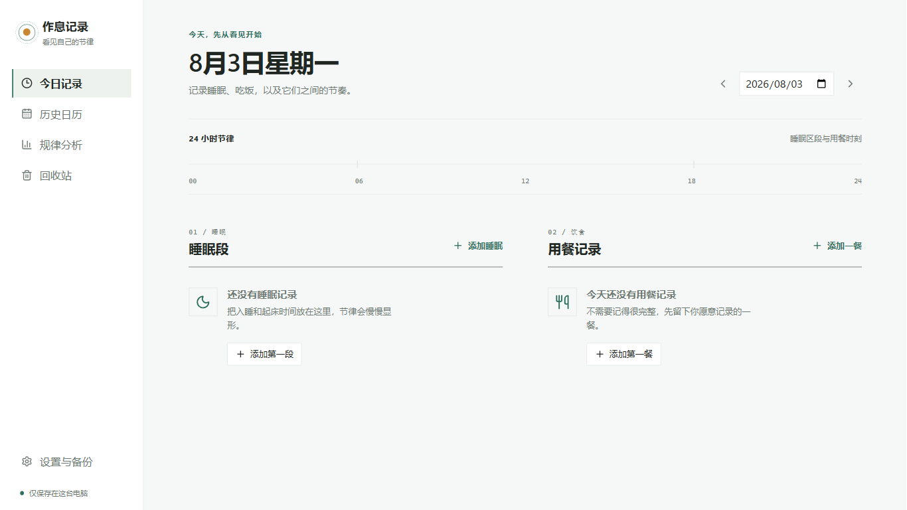
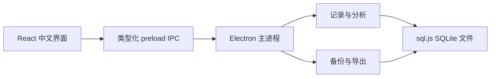

# 作息记录

Windows 离线作息记录软件，用来记录入睡、起床和用餐情况，按周、月或自选日期范围查看睡眠时长、餐次记录率和常见食物。

软件不需要账号，也不会把记录上传到服务器。分析只描述已经录入的数据，不提供医疗或营养建议，也不会把「未记录」解释为「没有吃饭」。



## 下载

Windows 10/11 x64 用户可前往 [v1.0.0 发布页](https://github.com/GodBook/zuoxi-jilu/releases/tag/v1.0.0) 下载：

| 下载 | 适合场景 | 数据位置 |
| --- | --- | --- |
| [安装版 `zuoxi-jilu-setup-1.0.0.exe`](https://github.com/GodBook/zuoxi-jilu/releases/download/v1.0.0/zuoxi-jilu-setup-1.0.0.exe) | 日常使用，可选择安装目录并创建快捷方式 | `%APPDATA%\作息记录` |
| [便携版 `zuoxi-jilu-portable-1.0.0.exe`](https://github.com/GodBook/zuoxi-jilu/releases/download/v1.0.0/zuoxi-jilu-portable-1.0.0.exe) | 放在 U 盘或任意文件夹中免安装运行 | EXE 同目录下的 `data` 文件夹 |

两个版本默认使用各自的数据目录。要在它们之间迁移记录，请在「设置与备份」中导出完整备份，再在另一个版本中恢复。

Release 下载文件使用英文名称，程序名称和本地构建产物仍为「作息记录」。安装包尚无代码签名，Windows SmartScreen 可能显示「未知发布者」。下载后可用 PowerShell 核对文件：

```powershell
Get-FileHash -Algorithm SHA256 '.\zuoxi-jilu-setup-1.0.0.exe'
Get-FileHash -Algorithm SHA256 '.\zuoxi-jilu-portable-1.0.0.exe'
```

| 文件 | SHA-256 |
| --- | --- |
| 安装版 | `E9A8BA4541634EF2F50EDAC24A0E08F1D239359AF22263BB61740638B87C4EBC` |
| 便携版 | `5EF9F3C841CB4E2BAD4773B146913116EF9547EA19479D611D3FE263AC0B8B0F` |

## 能记录什么

### 睡眠

- 按入睡和起床时间记录主睡眠或小睡，跨午夜的睡眠归到起床日。
- 每个起床日最多一段主睡眠，可以添加多段小睡。
- 自动计算单段与每日总睡眠时长。
- 检查结束时间、48 小时时长上限和睡眠区间重叠。
- 已有记录编辑停止 600 毫秒后自动保存，并显示保存中、已保存或校验错误状态。

### 饮食

- 记录早餐、午餐、晚餐、加餐或其他餐次。
- 一餐可填写多个食物标签；输入后按回车即可添加。
- 根据历史记录提供食物名称补全。
- 自动清理首尾空格、合并连续空格，并对大小写不同的重复标签去重。

### 回看与分析

- 首页用 24 小时时间轨同时显示睡眠区段和用餐时刻。
- 历史日历按月查看有记录的日期、睡眠时长和餐次数。
- 分析范围可选近 7 天、近 30 天或任意起止日期。
- 统计平均和中位睡眠时长、入睡与起床时间、记录天数、餐次规律及常见食物前十名。
- 午夜前后的时间采用圆周算法计算，避免把 23:30 和 00:30 当成相差 23 小时。
- 只有前后两段都具备足够记录、变化达到 30 分钟时，才生成趋势提示。

### 删除、导出和备份

- 删除后先移入回收站，页面提示支持 8 秒内撤销。
- 回收站中的记录可以恢复，也可以二次确认后永久删除。
- CSV 导出会生成带 UTF-8 BOM 的 `睡眠记录.csv` 和 `饮食记录.csv`，可直接用 Excel 打开。
- 完整备份为版本化 JSON，包含正常记录、回收站内容和主题设置。
- 恢复备份前，软件会先在当前数据目录保存一份安全副本。

## 基本使用

1. 打开软件后，在「今日记录」选择日期。
2. 点击「添加睡眠」，填写入睡和起床时间，再选择主睡眠或小睡。
3. 点击「添加一餐」，选择餐别和时间，逐个输入食物。
4. 到「历史日历」修改过去的记录，或在「规律分析」查看一段时间的统计。
5. 定期在「设置与备份」导出完整备份，并把备份文件放到其他磁盘。

主题可设置为跟随 Windows、浅色或深色。窗口最小尺寸为 960 x 640，主要操作支持键盘焦点导航。

## 数据与隐私

所有业务数据都保存在本机 SQLite 数据库中。渲染界面不能直接访问 Node.js、文件系统或数据库，只能调用预加载层中明确列出的接口。应用启用了 `contextIsolation`，关闭了 `nodeIntegration`、远程页面和 `<webview>`，并设置了内容安全策略。

数据库写入由主进程串行处理。每次变更在事务内执行，保存时轮换当前、候选和回退快照；如果写盘失败，内存状态也会回滚，界面不会把未落盘的数据显示成已保存。

请把 JSON 备份和 CSV 导出视为明文隐私数据。当前版本没有启动密码和数据库加密，安全边界是当前 Windows 用户账户。



## 技术栈

- Electron 43.2.0
- React 19.2.8 与 TypeScript 7.0.2
- electron-vite 5.0.0 与 Vite 7.3.6
- sql.js 1.14.1
- Recharts 3.10.1
- Lucide React 1.28.0
- electron-builder 26.15.3

项目使用 `sql.js` 读写 SQLite，无需编译原生 SQLite 模块。保存时导出数据库快照。

## 本地开发

需要 Windows 10/11 x64、Node.js 22 LTS 和 npm。克隆仓库后执行：

```powershell
npm install
npm run dev
```

常用命令：

| 命令 | 用途 |
| --- | --- |
| `npm run dev` | 启动开发版 Electron 应用 |
| `npm test` | 运行 Vitest 单元测试 |
| `npm run typecheck` | 检查主进程、预加载层和渲染进程类型 |
| `npm run build` | 构建主进程、预加载层和前端资源 |
| `npm run dist` | 依次测试、类型检查、构建并生成两个 EXE |

打包结果写入 `release` 目录。`sql-wasm.wasm` 会作为额外资源放入应用的 `resources` 目录。

## 目录结构

```text
作息记录/
├─ build/                 图标和打包资源
├─ docs/界面截图/        README 使用的界面截图
├─ src/
│  ├─ main/              Electron 主进程、SQLite 和文件操作
│  ├─ preload/           类型化 IPC 接口
│  ├─ renderer/          React 界面与样式
│  └─ shared/            数据类型、校验和分析算法
├─ tests/                 Vitest 测试
├─ package.json
└─ electron.vite.config.ts
```

## 测试与打包检查

当前测试覆盖跨日睡眠归档、睡眠重叠、圆周时间均值、趋势阈值、食物标签规范化等核心逻辑。v1.0.0 还完成了以下 Windows 实机检查：

- 安装版与便携版可以启动，重启后记录仍然存在。
- 便携版在 EXE 旁创建独立 `data` 目录。
- 安装器可完成静默安装；卸载后 `%APPDATA%\作息记录` 中的用户数据保留。
- 睡眠、饮食、分析、删除撤销和备份恢复流程可用。
- 安装包内包含主进程、预加载层、渲染资源、`sql.js` 和 `sql-wasm.wasm`。

## 已知限制

首版只面向单机个人使用，不包含账号、云同步、提醒、CSV 导入、营养素计算、医疗诊断和自动更新。软件不会判断某种食物是否健康，也不会根据缺失记录推断真实行为。

## 许可证

源码采用 [MIT License](LICENSE)。
